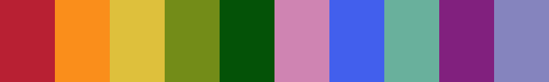

# omnicol

A ten-colour qualitative palette for R.



## Install

```r
remotes::install_github("btraven00/omnicol")
```

## Use

```r
library(omnicol)

omnicol
#>  [1] "#b82033" "#fa8e1b" "#dec03c" "#738c18" "#045207"
#>  [6] "#cf84b2" "#425fed" "#69b09c" "#81207e" "#8584be"

# base graphics
barplot(1:10, col = omnicol)

# ggplot2
ggplot2::scale_colour_manual(values = omnicol)
ggplot2::scale_fill_manual(values = omnicol)

# colour-blind safety check
pals::pal.safe(omnicol, main = "omnicol")
```

## Editor themes

Dark themes built on the palette live in [`themes/`](themes):

- **Vim / Neovim**: copy `themes/vim/colors/omnicol.vim` to `~/.vim/colors/` (Neovim: `~/.config/nvim/colors/`), then `set termguicolors` and `colorscheme omnicol`.
- **Helix**: copy `themes/helix/omnicol.toml` to `~/.config/helix/themes/`, then set `theme = "omnicol"`.
- **Zed**: copy `themes/zed/omnicol.json` to `~/.config/zed/themes/`, then pick *omnicol* in the theme selector.

## Authorship

This palette is a collective work, composed during a coffee-cake-and-code
session on the fifth of November, *Anno Domini* 2026.
